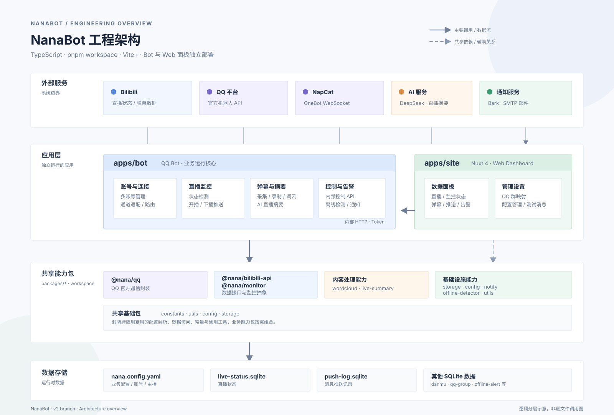

<div align="center">

# NanaBot

**面向 B 站直播与 UP 主动态的 TypeScript QQ 机器人与可视化运维面板**

支持 **QQ 官方 Bot API** 与 **NapCat WebSocket** 双通道多账号混合运行，内置弹幕词云、AI 直播摘要与 Nuxt 4 控制台。

[](https://nodejs.org/)
[](https://pnpm.io/)
[](https://www.typescriptlang.org/)
[](https://nuxt.com/)
[](https://viteplus.dev/)
[](https://github.com/QiYuOr2/NanaBot/actions/workflows/bot.yml)
[](https://github.com/QiYuOr2/NanaBot/actions/workflows/site.yml)

[核心特性](#核心特性) · [工程架构](#工程架构) · [快速开始](#快速开始) · [配置指南](#配置指南) · [Web 控制台](#web-控制台) · [部署与运维](#部署与运维) · [开发与贡献](#开发与贡献)

</div>

---

## 核心特性

- **B 站直播监控**：支持多直播间开播、下播与超管切断监控，自定义通知模板与 `{@all}` 全体提醒；内置异常中断宽限期防抖，短时断流重开视为同一场续播，避免重复打扰。
- **UP 主动态监控**：独立于直播监控运行，轮询视频、图文与专栏动态；首次启用仅同步基线不刷屏，支持去重持久化、通道配额适配、图片失败自动降级纯文本以及重启续发。
- **双通道多账号混合**：同一进程可同时接入多个 **QQ 官方机器人** 与 **NapCat** 实例，账号间连接、管理群与日志文件完全隔离，单个账号异常不影响其余账号运行。
- **弹幕录制、词云与 AI 摘要**：开播自动录制弹幕至 SQLite，下播自动分词并渲染场次词云 PNG 推送到指定群；可选接入 DeepSeek 生成基于弹幕的直播摘要。
- **群内指令与自动回复**：内置 `/status`、`/live`、`/help` 等指令及自定义别名，支持按作用域（群聊 / 私聊）与冷却时间配置关键词自动回复规则。
- **Web 运维控制台**：基于 Nuxt 4 + UnoCSS，集中展示实时直播状态、推送活动时间轴、弹幕词云、离线告警、项目日志与服务器硬件状态，并支持在线绑定官方 QQ 群 `openid` 与发信测试。
- **离线告警与独立部署**：支持断连确认与恢复通知（SMTP 邮件 / Bark）；提供 `pnpm app` 单应用 PM2 部署命令及 GitHub Actions 自动化构建部署流水线。

## 工程架构



仓库为基于 pnpm workspace 的 Monorepo，由 [Vite+](https://viteplus.dev)（`vp`）统一管理构建、格式化、Lint 与测试：

- **`apps/bot`**：核心机器人进程，负责 QQ 双通道连接、B 站直播 / 动态监控、弹幕录制、词云与摘要生成、离线告警及仅监听本机的内部控制接口。
- **`apps/site`**：Nuxt 4 Web 管理面板，共享项目根目录下的配置与 `db/*.sqlite` 数据文件；不接触机器人密钥，测试发信等操作通过本机控制接口交由运行中的 `bot` 执行。

## 环境要求

- **Node.js** `>= 22.18.0`
- **pnpm** `11.20.0`（仓库已在 `package.json#devEngines` 中锁定版本）
- **QQ 通道凭据**（至少其一）：
  - QQ 官方机器人的 `AppID` 与 `AppSecret`（推荐，无需公网回调或额外客户端）
  - 可用的 [NapCat](https://github.com/NapNeko/NapCatQQ) WebSocket 服务

## 快速开始

### 1. 克隆仓库并安装依赖

```bash
git clone https://github.com/QiYuOr2/NanaBot.git
cd NanaBot
pnpm install
```

### 2. 配置环境变量

复制环境变量模板并填写必要项（所有 `.env` 文件均已加入 `.gitignore`）：

```bash
cp .env.example .env
cp apps/bot/.env.example apps/bot/.env
cp apps/site/.env.example apps/site/.env
```

1. **根目录 `.env`**：设置全站登录与内部控制接口共用的管理口令 `NANA_AUTH_TOKEN`（至少 16 位，可用 `openssl rand -hex 24` 生成）。
2. **`apps/bot/.env`**：填写 QQ 官方机器人的 `QQ_BOT_APP_ID` / `QQ_BOT_APP_SECRET`，或 NapCat 的 `NC_WS_URL` / `NC_ACCESS_TOKEN`。
   > 使用官方机器人时，也可在配置好 `nana.config.yaml` 后直接扫码绑定，凭据会自动写入 `apps/bot/.env`：
   >
   > ```bash
   > vp run @nana/bot#qq:bind
   > ```

### 3. 创建监控配置

```bash
cp nana.config.yaml.example nana.config.yaml
```

编辑 `nana.config.yaml`，配置 `accounts`（QQ 账号列表）与 `up`（要监控的 B 站主播 / UP 主），完整字段说明见 [`nana.config.yaml.example`](./nana.config.yaml.example)。

### 4. 启动服务

**本地运行 Bot：**

```bash
pnpm build:bot
node apps/bot/dist/index.mjs
```

**运行 Web 控制台：**

```bash
pnpm dev:site       # 开发模式（默认 http://localhost:3000）
pnpm build:site     # 生产构建（输出至 apps/site/.output）
```

**使用 PM2 一键运行生产服务：**

```bash
pnpm app deploy all # 依次构建并启动/重启 @nana/bot 与 @nana/site
```

## 配置指南

全量配置示例见 [`nana.config.yaml.example`](./nana.config.yaml.example)。修改凭据、账号通道或主播归属后需重启 Bot；通过 Web 面板修改官方群映射后实时生效，无需重启。

### 账号与通道（`accounts`）

所有账号统一配置在顶层 `accounts` 列表中，通过 `provider` 指定通道（`official` / `napcat`），连接参数放在同名子段：

```yaml
accounts:
  - id: live
    name: 直播通知（官方 API）
    provider: official
    enabled: true
    adminGroup: 100000002
    official:
      appIdEnv: QQ_BOT_APP_ID
      appSecretEnv: QQ_BOT_APP_SECRET
    groups: {} # 启动后在 Web 面板「设置」中绑定

  - id: main
    name: 主号（NapCat）
    provider: napcat
    enabled: true
    adminGroup: 100000001
    napcat:
      watchdog: false # 长期运行可设为 true 开启自动探活与重连
      wsUrlEnv: NC_WS_URL
      accessTokenEnv: NC_ACCESS_TOKEN
```

- 每个主播必须通过 `up[].qqAccount` 显式指定发送账号；未指定时不会分配默认账号，也不启动监控或推送。
- `accounts[].enabled: false` 可在不删除配置的前提下停用该账号及其名下任务。
- 单账号缺少凭据或启动失败仅跳过自身，不会将消息改发到其他账号。

### 直播监控（`up[].live`）

仅 `live: true` 的条目会启用直播监控：

```yaml
liveMonitor:
  gracePeriodSeconds: 600 # 异常中断宽限期（秒），宽限期内重开视为续播且不 @全体
  minNormalLiveSeconds: 1800 # 低于该时长的下播将进入宽限期

up:
  - uname: 示例主播
    uid: 10001
    liveRoomId: 1000001
    live: true
    qqAccount: live
    liveMonitorConfig:
      enableNotify: true
      notifyGroups: [100000003]
      messageTemplate:
        start: "{uname}开播了 https://live.bilibili.com/{roomId} {@all}"
```

| 字段                                      | 说明                                             |
| ----------------------------------------- | ------------------------------------------------ |
| `live`                                    | 是否开启直播监控                                 |
| `uid` / `liveRoomId` / `uname`            | B 站用户 UID / 直播间 ID / 展示名称              |
| `qqAccount`                               | 负责该主播监控与推送的账号 `id`                  |
| `liveMonitorConfig.enableNotify`          | 是否向 QQ 群发送直播通知                         |
| `liveMonitorConfig.notifyGroups`          | 目标群号（官方通道填 `groups` 中对应的数字别名） |
| `liveMonitorConfig.messageTemplate.start` | 开播文案，支持 `{uname}`、`{roomId}`、`{@all}`   |

### UP 主动态监控（`up[].dynamic`）

动态监控与直播监控**相互独立**（可仅开启 `dynamic: true` 而关闭 `live`）。首次启用某 UP 主时仅记录当前可见动态作为基线，不推送历史内容：

```yaml
up:
  - uname: 示例 UP 主
    uid: 10001
    liveRoomId: 1000001
    qqAccount: live
    live: false
    dynamic: true
    dynamicMonitorConfig:
      enableNotify: true
      notifyGroups: [100000003] # 留空则仅抓取入库，不推送
      types: [video, opus, draw] # 可选：video / opus / draw / article
      pollIntervalMinutes: 5 # 轮询间隔（1–60 分钟）
```

- 自动忽略置顶动态与转发动态；单 UID 失败按指数退避重试，不影响其他 UP 主。
- 图片按通道能力发送（NapCat 单条最多 3 张，官方 QQ 单条 1 张），图片发送失败自动降级为文本 + 原动态链接。
- 若匿名请求触发 B 站风控（HTTP 412），可在 `apps/bot/.env` 中配置 `BILIBILI_COOKIE`（原始 Cookie 请求头，不会写入日志）。

### 词云、AI 摘要、消息互动与告警

- **弹幕词云**：在主播条目下启用 `wordcloud.enabled` 与 `notifyGroups`，顶层 `wordcloud` 段可统一配置分词长度、停用词与字体路径。
- **AI 直播摘要**：在 `apps/bot/.env` 中填写 `DEEPSEEK_API_KEY`，下播后自动基于本场弹幕生成摘要并推送，也可在 Web 面板词云页手动补生成。
- **消息指令与自动回复**：通过顶层 `message`（或 `accounts[].message` 覆盖）配置命令前缀、别名、关键词回复规则、会话白名单/黑名单及冷却时间。
- **上下线提醒**：通过 `botNotifications.online` / `offline` 自定义模板（支持 `{accountId}`、`{accountName}`、`{provider}`），发送至各账号的 `adminGroup`。
- **离线告警**：配置 `adminEmail`（并在 `apps/bot/.env` 填写 `SERVER_EMAIL` / `SERVER_EMAIL_PASSWORD`）或 `BARK_KEY`，结合 `offlineDetector` 在断连确认与恢复时发出告警。

<details>
<summary><strong>QQ 官方机器人接入与权限详解</strong></summary>

NanaBot 通过 [`@nana/qq`](./packages/qq/README.md) 封装 [`@tencent-connect/qqbot-nodejs`](https://github.com/tencent-connect/qqbot-nodejs) 连接官方 WebSocket Gateway，自动处理 Token 刷新、心跳与重连，无需公网回调地址。

1. **创建机器人**：在 [QQ 开放平台](https://q.qq.com/) 或 [官方 Agent 接入入口](https://bot.q.qq.com/wiki/agent-qqbot/) 创建机器人。
2. **绑定凭据**：在 `apps/bot/.env` 手动填写 `QQ_BOT_APP_ID` / `QQ_BOT_APP_SECRET`，或执行扫码绑定（默认选中第一个官方账号，也可显式指定账号 ID）：
   ```bash
   vp run @nana/bot#qq:bind live
   ```
3. **绑定群 `openid`**：官方 API 使用字符串格式的 `group_openid`（不可跨机器人复用），配置中的数字键仅作为本地别名。
   - **推荐方式**：启动 Bot 后在目标群 `@机器人` 发送任意消息，再到 Web 面板「设置 → QQ 群映射」刷新选择候选并保存。
   - **命令行方式**（独立运行，请勿与运行中的同一 Bot 账号同时连接）：
     ```bash
     vp run @nana/bot#qq:discover live
     ```
4. **平台与群权限要求**：
   - 由群主在机器人设置中开启「机器人主动在群聊内发言」；若需接收不 `@` 机器人的普通群消息，另需开启「获取群内全部消息」。
   - 消息包含直播间或动态链接时，需按开放平台要求配置 URL / 域名白名单及服务端 IP 白名单。
   - `{@all}` 会转换为官方标记 `<qqbot-at-everyone />`，要求机器人为**群管理员**且**每群每天限用一次**；权限不足或额度耗尽时记录为失败，不会去掉提醒后降级为普通消息重发。

参考文档：[官方 API 准备工作](https://bot.q.qq.com/wiki/develop/api-v2/dev-prepare/getting-started.html) · [Agent 接入及群权限说明](https://bot.q.qq.com/wiki/agent-qqbot/) · [官方 SDK 文档](https://github.com/tencent-connect/qqbot-nodejs/blob/main/USAGE.md)

</details>

<details>
<summary><strong>环境变量速查表</strong></summary>

| 文件             | 变量名                                   | 必填 | 说明                                                         |
| ---------------- | ---------------------------------------- | ---- | ------------------------------------------------------------ |
| `.env`           | `NANA_AUTH_TOKEN`                        | 是   | 全站登录与 Bot 内部控制接口共用的管理口令（至少 16 位）      |
| `.env`           | `NANA_BRIDGE_TOKEN`                      | 否   | 可选私聊桥接专用口令（需与 `apps/bot/.env` 保持一致）        |
| `apps/bot/.env`  | `QQ_BOT_APP_ID` / `QQ_BOT_APP_SECRET`    | 按需 | QQ 官方机器人凭据（多账号可在配置中自定义变量名）            |
| `apps/bot/.env`  | `NC_WS_URL` / `NC_ACCESS_TOKEN`          | 按需 | NapCat WebSocket 地址与鉴权 Token                            |
| `apps/bot/.env`  | `NC_DEBUG`                               | 否   | 设为 `1` 开启 NapCat 调试日志                                |
| `apps/bot/.env`  | `BILIBILI_COOKIE`                        | 否   | 动态监控用的 B 站登录 Cookie（匿名触发 HTTP 412 风控时使用） |
| `apps/bot/.env`  | `DEEPSEEK_API_KEY`                       | 否   | DeepSeek API Key，用于生成直播弹幕摘要                       |
| `apps/bot/.env`  | `SERVER_EMAIL` / `SERVER_EMAIL_PASSWORD` | 否   | 离线告警发件邮箱与 SMTP 授权码                               |
| `apps/bot/.env`  | `BARK_KEY`                               | 否   | Bark 推送 Key，用于移动端离线告警                            |
| `apps/bot/.env`  | `NANA_BOT_CONTROL_PORT`                  | 否   | Bot 本机控制接口端口，默认 `6365`                            |
| `apps/site/.env` | `NANA_BOT_CONTROL_URL`                   | 否   | Bot 控制接口地址，默认 `http://127.0.0.1:6365`               |

</details>

## Web 控制台

`apps/site` 提供面向日常监控与运维的 Web 面板，除登录接口与 `/api/health` 健康检查外，所有页面与 API 均受根目录 `.env#NANA_AUTH_TOKEN` 鉴权保护（登录后通过 HttpOnly Cookie 保持 30 天会话）。

| 路由        | 页面       | 功能说明                                                                  |
| ----------- | ---------- | ------------------------------------------------------------------------- |
| `/`         | 概览       | 主播实时直播状态、标题、分区、人气（支持手动刷新）与最近推送活动时间轴    |
| `/monitor`  | 直播监控   | 按主播查看监控配置、状态与直播间详情                                      |
| `/danmu`    | 弹幕词云   | 按场次浏览弹幕记录、词频统计、词云图以及 AI 直播摘要（支持手动补生成）    |
| `/alerts`   | 告警       | 机器人在线/离线状态与历史离线/恢复告警记录                                |
| `/pushes`   | 推送活动   | 完整群推送日志查询（开播、动态、词云、摘要、测试消息及送达状态）          |
| `/logs`     | 项目日志   | 在线查看 `logs/` 下全局与各账号日志末尾内容（带路径与符号链接安全校验）   |
| `/system`   | 服务器状态 | 按刷新采集 CPU、内存、交换空间、磁盘及 NVIDIA GPU（不可用时自动降级）     |
| `/settings` | 设置       | 在线绑定官方 QQ 群 `openid`（保留 YAML 注释），支持测试普通消息与 `@全体` |

> 安全设计：Web 面板不读取也不向浏览器返回任何机器人密钥；测试消息由面板转发给运行中的 Bot 控制接口执行，不会创建额外连接。

## 部署与运维

### PM2 独立应用管理

Bot 与 Web 面板拥有各自独立的 PM2 配置（`apps/bot/ecosystem.config.cjs` 与 `apps/site/ecosystem.config.cjs`），支持单独构建和重启，互不影响：

```bash
pnpm app list                               # 列出可管理的应用
pnpm app deploy bot                         # 构建并重启 @nana/bot
pnpm app deploy site                        # 构建并重启 @nana/site
pnpm app deploy all                         # 部署全部应用
pnpm app deploy site --stop-before-build    # 构建前先停服，降低低内存机器 OOM 风险
pnpm app deploy bot --no-build              # 跳过构建，仅重启进程
pnpm app restart|stop|logs <app>            # 重启 / 停止 / 查看实时日志
```

### 运行日志

Bot 直接将日志写入项目根目录 `logs/`，并按账号拆分为独立文件（单文件默认 10 MiB 轮转，保留 5 份历史）：

```text
logs/
  bot.log                 # 进程生命周期与全局事件
  accounts/
    <account-id>.log      # 各账号独立的连接、监控、推送与弹幕日志
```

<details>
<summary><strong>GitHub Actions 自动构建与部署（CI/CD）</strong></summary>

针对小内存服务器，仓库提供了两条 Linux x64 自动构建与部署工作流：

- [`.github/workflows/bot.yml`](./.github/workflows/bot.yml)：构建测试 `@nana/bot`、打包生产依赖并校验原生模块（`@node-rs/jieba`、`@resvg/resvg-js`），上传 `bot-output-<sha>` artifact。
- [`.github/workflows/site.yml`](./.github/workflows/site.yml)：构建 `@nana/site`、执行 `/api/health` 冒烟测试，上传 `site-output-<sha>` artifact。

在仓库 Secrets 中配置以下变量即可在推送后自动 SSH 部署（并在健康检查失败时自动回滚）；未配置时仅构建并保留 artifact：

| Secret           | 说明                        |
| ---------------- | --------------------------- |
| `DEPLOY_HOST`    | 目标服务器地址              |
| `DEPLOY_PORT`    | SSH 端口（可选，默认 `22`） |
| `DEPLOY_USER`    | SSH 登录用户名              |
| `DEPLOY_SSH_KEY` | SSH 私钥                    |
| `DEPLOY_PATH`    | 服务器上的项目绝对路径      |

</details>

## 项目结构

```text
apps/
  bot/                 # QQ 机器人主程序（双通道、监控、弹幕、词云、摘要、内部控制接口）
  site/                # Web 运维控制台（Nuxt 4 + UnoCSS）
packages/
  bilibili-api/        # B 站直播状态与 UP 主动态 API 封装
  config/              # nana.config.yaml 解析、校验与保留注释的原子更新
  constants/           # 共享常量、环境变量名与推送目的枚举
  live-summary/        # 弹幕抽样与 DeepSeek 直播摘要生成
  monitor/             # B 站直播间事件监听抽象
  napcat/              # NapCat WebSocket 客户端封装
  notify/              # 邮件（SMTP）与 Bark 告警通知
  offline-detector/    # 离线状态确认与恢复检测器
  qq/                  # QQ 官方机器人通信、消息编码、@全体校验与扫码授权
  storage/             # db/ 下的 SQLite 与 YAML 持久化（状态、推送、弹幕、动态、群发现）
  utils/               # 通用工具（项目根定位、鉴权口令读取等）
  wordcloud/           # 中文分词、场次词频统计与词云 SVG/PNG 渲染
docs/                  # 架构图、技术设计文档与变更记录
scripts/               # 应用管理脚本与 CI 部署脚本
db/                    # 运行时 SQLite 数据库（已 gitignore）
logs/                  # 运行时轮转日志（已 gitignore）
nana.config.yaml       # 本地运行时配置（已 gitignore）
ecosystem.config.cjs   # PM2 合并入口
```

## 开发与贡献

### 常用命令

| 命令                                             | 说明                                |
| ------------------------------------------------ | ----------------------------------- |
| `vp install` / `pnpm install`                    | 安装并链接 Workspace 依赖           |
| `vp check`                                       | 统一执行格式化检查、Lint 与类型检查 |
| `vp test`                                        | 运行全仓 Vitest 单元测试            |
| `pnpm dev:site`                                  | 启动 Web 控制台开发服务器           |
| `pnpm build:bot` / `pnpm build:site`             | 构建 Bot / Web 面板                 |
| `pnpm app <list\|deploy\|restart\|stop\|logs>`   | 按应用名管理本地或生产进程          |
| `pnpm pm2:start` / `restart` / `stop` / `delete` | 通过根目录 PM2 配置批量管理所有应用 |

### 文档索引

- [Bilibili UP 主动态推送设计](./docs/design/bilibili-dynamic-monitor.md)
- [弹幕录制与词云技术方案](./docs/plan/danmu-wordcloud.md)
- [`@nana/qq` 通信包文档](./packages/qq/README.md)
- [项目功能变更记录](./docs/changes/README.md)

### 参与贡献

欢迎通过 Issue 反馈问题、提出建议或直接提交 Pull Request：

1. Fork 本仓库并基于默认分支创建特性分支（如 `feat/your-feature` 或 `fix/your-bug`）。
2. 完成修改后，在仓库根目录运行 `vp check` 与 `vp test` 确保格式、类型检查与测试全部通过。
3. 请勿提交 `.env`、`nana.config.yaml`、`db/*.sqlite`、`logs/` 等本地敏感配置或运行时文件。

## 致谢与免责声明

感谢以下开源项目与社区资料为 NanaBot 提供的支持：

- [@tencent-connect/qqbot-nodejs](https://github.com/tencent-connect/qqbot-nodejs) · [node-napcat-ts](https://github.com/HkTeamX/node-napcat-ts) · [blive-message-listener](https://github.com/ddiu8081/blive-message-listener) · [bilibili-API-collect](https://github.com/pskdje/bilibili-API-collect) · [Vite+](https://viteplus.dev) · [Nuxt](https://nuxt.com)

> [!NOTE]
> 本项目仅供学习交流与个人自建使用。使用过程中请合理控制轮询与推送频率，遵守 B 站及 QQ 开放平台的相关服务条款与规范。
