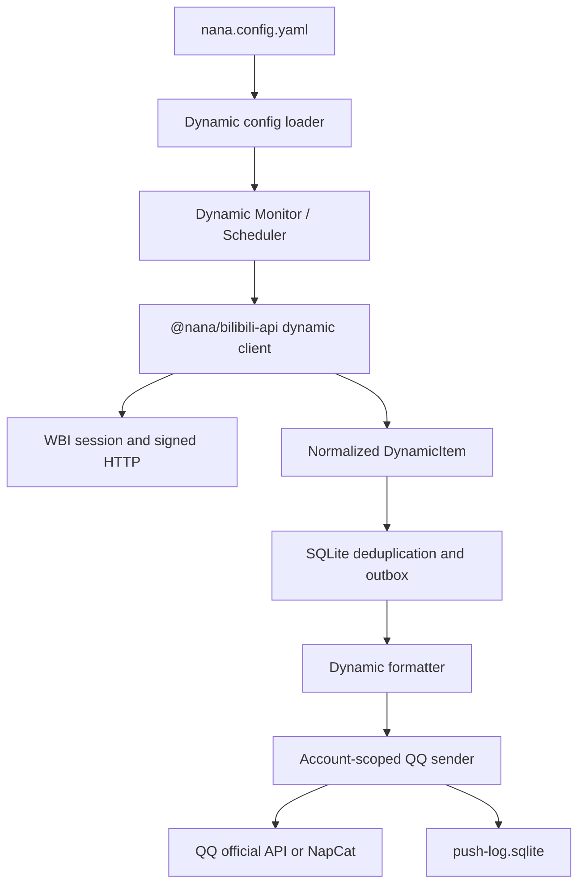

# Bilibili UP 主动态推送技术设计

- 状态：待实施
- 目标分支：v2
- 范围：Bot 端视频、图文及可选专栏动态监控与 QQ 群推送
- 关联模块：@nana/bilibili-api、apps/bot、@nana/storage、@nana/constants

## 1. 背景与目标

NanaBot 已有 Bilibili 直播监控、按 UP 主指定 QQ 账号发送消息、QQ 官方 API / NapCat 双通道、SQLite 推送日志等基础设施。本功能增加 UP 主空间动态监控，第一阶段重点支持视频和图文动态。

Boku 仓库的 Bilibili 动态实现可作为协议与边界处理的参考：

- apps/desktop/internal/bilibili/service.go
- apps/desktop/internal/bilibili/session.go
- apps/desktop/internal/bilibili/service_test.go

Boku 是 Go 实现；NanaBot 是 TypeScript monorepo。实施时移植协议逻辑与测试场景，不复制 Go 代码或引入桌面端依赖。

### 1.1 目标

1. 通过 Bilibili Web 动态 Feed 获取指定 UID 的公开动态。
2. 复用 Boku 已验证的匿名 Cookie、WBI 签名、密钥刷新及异常响应处理思路。
3. 第一阶段支持视频、图文（包括新版 Opus 图文）和图片动态；专栏作为可选兼容类型。
4. 每个 UP 主独立启停、独立设置动态通知群，继续使用其 qqAccount 选择 QQ 发送账号。
5. 通过 SQLite 去重、持久化待推送任务，支持进程重启后的恢复。
6. 复用现有 QQ 发送适配层与 push-log.sqlite，不创建第二套 QQ 连接或推送日志。
7. 动态监控与直播监控生命周期独立，允许只监控动态、不监控直播。

### 1.2 非目标

第一版不做动态评论/点赞，不主动登录用户 B 站账号，不抓取私有或仅登录可见内容，不实现 Web 动态浏览器，不实现关键词过滤、复杂订阅规则或单独的推送管理后台。B 站接口可能发生变化或触发风控，匿名访问不承诺始终可用。

## 2. 当前架构与接入约束

当前代码入口与约束：

- packages/bilibili-api/src/index.ts 目前导出直播 API；动态 API 应扩展在同一个 package。
- apps/bot/src/monitor/config.ts 当前只解析 live: true 的主播。动态配置必须有独立 loader，不能复用只筛选直播主播的 loadMonitorConfig()。
- apps/bot/src/monitor/feature.ts 的 Sink 设计服务于直播间长连接。动态是 HTTP 轮询任务，不应塞进直播间 Sink，也不应为动态创建额外直播 WebSocket。
- apps/bot/src/index.ts 是应用组合入口，动态监控应在这里与账号运行时组合，生命周期纳入现有启动/关闭流程。
- @nana/qq 与 @nana/napcat 是通信适配层；业务模块不应直接依赖某一种 provider。
- @nana/storage 已提供 SQLite 存储模式，push-log.sqlite 已支持 purpose、content、subject 等字段。
- 主播的 qqAccount 是明确的账号归属。未配置或不可用时不得回退到默认账号，也不得把推送转交给其他账号。
- 当前 nana.config.yaml.example 中可能已有未进入运行时 Schema 的动态配置占位。实施前应以 v2 实际文件为准，统一补齐示例、Zod Schema 和运行时类型。

## 3. 总体架构



职责边界：

- API package：只负责 HTTP、WBI、Cookie、响应类型和动态数据标准化，不读 NanaBot 配置、不写业务数据库、不发送 QQ。
- Bot dynamic 模块：负责配置、轮询调度、类型过滤、动态发现、推送编排和日志。
- Storage package：负责动态记录、监控游标和待推送状态的持久化。
- QQ 账号运行时：提供按明确账号 ID 发送消息的能力；动态业务不自行创建 QQ client。

## 4. Bilibili API 设计

### 4.1 Feed 接口

优先沿用 Boku 当前实现的 Web 动态 Feed：

```http
GET https://api.bilibili.com/x/polymer/web-dynamic/v1/feed/space
```

关键参数按 Boku 实现核对，通常包含 host_mid、platform=web、features=itemOpusStyle，并按要求附加 WBI 签名参数。不要仅凭本文硬编码接口参数；以 Boku 当前源码、真实响应 fixture 和本次测试结果为准。

### 4.2 建议文件结构

在 packages/bilibili-api/src 内扩展：

```text
dynamic/
  index.ts       # 动态 API 对外导出
  client.ts      # Feed 请求与分页/请求参数
  session.ts     # 匿名 Cookie、WBI key 缓存与刷新
  wbi.ts         # mixin key、签名参数生成
  parser.ts      # 响应解析与统一 DynamicItem
  types.ts       # API 原始响应与标准化类型
```

可根据现有 package 的命名与模块规模调整，但不要为了目录对称而过度拆分。

### 4.3 标准化数据模型

API 层向 Bot 输出稳定的领域类型，避免 Bot 直接依赖 B 站嵌套响应：

```ts
type BilibiliDynamicType = "video" | "opus" | "draw" | "article" | "forward" | "unknown";

interface BilibiliDynamic {
  id: string;
  uid: number;
  type: BilibiliDynamicType;
  publishedAt: string | null;
  text: string;
  title: string | null;
  url: string;
  coverUrl: string | null;
  imageUrls: string[];
}
```

实际实现应结合现有 TypeScript 风格补充 author 信息及可选字段。动态 ID 始终按字符串保存。原始响应类型应对未知字段保持兼容，解析器遇到未知动态类型时返回 unknown，不能让单条未知动态导致整页解析失败。

### 4.4 类型解析要求

- 视频：识别 DYNAMIC_TYPE_AV，提取视频标题、封面、BV 号/播放地址。
- Opus 图文：读取 major.opus，正文优先从 summary.text 提取，并提取图片列表。
- 旧式图片动态：识别 DYNAMIC_TYPE_DRAW，提取描述和图片。
- 专栏：识别 DYNAMIC_TYPE_ARTICLE，提取标题、摘要、封面和链接。
- 转发：第一版可以识别并忽略，或按配置明确启用；不能把转发内容误解析成原创视频/图文。
- 置顶动态：按 Boku 当前实现过滤，不作为新动态推送。
- 文本字段可能缺失、为空或含富文本结构；解析必须容错。
- URL、图片地址只使用 API 返回或按已验证规则生成的地址，不拼接未经验证的字段。

### 4.5 WBI、匿名会话和风控

移植 Boku 的关键行为：

1. 通过 B 站公开导航接口获取 WBI image/sub key，并按 Boku 的算法生成 mixin key。
2. 缓存 key，避免每个 UP 主、每次轮询都重新请求。
3. 维护请求所需的匿名 Cookie（如 buvid3 等），不要求用户提供 SESSDATA。
4. 统一设置合理的 User-Agent、Referer 和请求超时。
5. 遇到签名失效（例如 -352）时刷新 key 并有限重试。
6. 遇到风控（例如 -412）、HTTP 错误、JSON 格式错误时返回明确错误，不得伪装成空动态。
7. 对成功响应但数据为空的情况，参考 Boku 的防误判重试策略；重试次数有限，不能形成请求风暴。
8. 统一限流和并发控制由 Dynamic Monitor 管理；API client 仍应有单请求超时。

错误应区分网络错误、HTTP 错误、Bilibili 业务码错误、签名错误和风控错误，便于日志与后续退避策略判断。

## 5. 动态监控与调度

### 5.1 文件结构

建议新增 apps/bot/src/dynamic/：

```text
dynamic/
  index.ts
  config.ts
  monitor.ts
  scheduler.ts
  deduplicator.ts
  formatter.ts
  sender.ts
```

可以按现有 Bot feature / account runtime 模式调整，不要求机械照搬文件拆分。

### 5.2 配置模型

主播列表仍然使用现有顶层 up，动态监控开关与直播监控开关互相独立：

```yaml
up:
  - uname: 示例主播
    uid: 10001
    liveRoomId: 1000001
    qqAccount: main
    live: true
    liveMonitorConfig:
      enableNotify: true
      notifyGroups: [123456789]
      messageTemplate:
        start: "{uname} 开播了"

    dynamic: true
    dynamicMonitorConfig:
      enableNotify: true
      notifyGroups: [123456789]
      types:
        - video
        - opus
        - draw
        # article 可选
      pollIntervalMinutes: 5
```

Schema 约束：

- dynamic 默认 false，保持旧配置兼容。
- dynamicMonitorConfig.enableNotify 默认 true，但仅在 dynamic: true 时生效。
- notifyGroups 默认为空数组；空数组表示不发送 QQ 群消息，但仍可按设计监控/记录，需在文档中明确。
- types 有受限枚举和合理默认值，第一版默认 video/opus/draw。
- pollIntervalMinutes 默认 5，设置合理上下限，避免过高频率。
- 继续复用主播的 qqAccount；未配置时记录警告并跳过发送，绝不回退到其他账号。
- 动态通知群与直播通知群独立。
- 独立 loader 应读取所有 up，不能要求 live: true。

### 5.3 调度策略

采用一个可停止的 Scheduler 管理多个 UP 主，不为每个 UP 主创建永久独立 timer。

- 默认每 5 分钟检查一次；允许配置覆盖，但必须限制最小轮询间隔。
- 每个 UID 任务互相隔离，单个 UID 失败不阻塞其他 UID。
- 全局并发建议默认 3，任务间增加随机抖动。
- 不允许同一 UID 的上一轮尚未结束时再次并发执行。
- 使用 AbortSignal 或等价生命周期机制，在 Bot 关闭时停止等待和后续轮询。
- 失败时保留旧游标，采用有上限的退避；成功后恢复正常间隔。
- 日志记录 UID、耗时、结果数量、错误类别，不输出 Cookie、签名或敏感请求头。

## 6. 去重、首次同步与持久化

### 6.1 首次同步

每个 UID 第一次启用时执行 bootstrap：

1. 请求最新动态。
2. 将本次可见动态写入已知记录，标记为 bootstrap/不推送。
3. 保存成功同步游标与检查时间。
4. 后续成功轮询发现的新 ID 才进入推送队列。

bootstrap 必须按 UID 独立进行。新增一个 UP 主不能影响其他 UP 主的游标。若首次请求失败，不得把该 UID 标记为已初始化。

### 6.2 数据表

新增独立数据库 db/dynamic.sqlite，避免将动态业务数据混入 live-status.sqlite 或弹幕数据库。

建议表：

**dynamic_item**

- dynamic_id TEXT PRIMARY KEY
- uid INTEGER NOT NULL
- type TEXT NOT NULL
- title TEXT
- content TEXT
- url TEXT NOT NULL
- cover_url TEXT
- image_urls TEXT（JSON 序列化）
- published_at TEXT
- discovered_at TEXT NOT NULL
- push_status TEXT NOT NULL：bootstrap / pending / success / failed / skipped
- pushed_at TEXT
- last_error TEXT

**dynamic_monitor_state**

- uid INTEGER PRIMARY KEY
- initialized INTEGER NOT NULL
- last_dynamic_id TEXT
- last_checked_at TEXT
- updated_at TEXT NOT NULL

索引至少覆盖 uid, discovered_at 和 push_status, discovered_at。建表和升级逻辑应幂等。数据库 API 使用项目现有 node:sqlite 风格，确保每次操作关闭连接或按现有 storage 约定复用连接。

### 6.3 发现与 outbox

一次成功轮询的顺序：

1. 获取完整、有效的动态响应。
2. 解析、过滤置顶和不订阅的类型。
3. 使用事务写入动态记录，唯一键保证去重；新动态标记 pending。
4. 更新 UID 的同步游标与 last_checked_at。
5. 事务提交后再发送 pending 项。
6. 成功发送后标记 success 并写入统一推送日志；失败记录错误并保留可重试状态。

不能在请求失败、风控、解析失败或不可信空响应时推进游标。动态发现与 QQ 发送不能放在同一个不可恢复的内存流程中。

重启后应能扫描 pending 项并继续发送。失败重试应有次数/时间退避上限，并避免每次启动立即对同一失败任务无限重试。需明确发送成功但进程在落库前退出时可能产生重复发送；可通过消息发送后尽快提交状态降低窗口，但 QQ 发送和 SQLite 无法构成分布式原子事务。

### 6.4 数据保留

第一版可以保留全部已发现动态；若考虑数据库增长，可在后续增加按时间清理策略。不要在第一版清理 pending/failed 项。图片只保存 URL，不下载原图到服务器数据库。

## 7. QQ 消息格式与发送

### 7.1 发送边界

动态 sender 通过现有账号运行时获取指定 qqAccount 的发送能力。不能在 dynamic 模块内 new QQClient、NapCat client，也不能根据某通道失败自动切换 provider。

先检查现有账号 app 暴露的发送接口和消息类型，尽量复用。若现有类型无法表达多图消息，扩展共享消息类型/适配器，而不是让动态模块直接调用底层 SDK。

### 7.2 消息内容

视频动态：

- UP 主名称
- 视频标题
- 发布时间（可用时）
- 封面图（可用时）
- 视频/动态链接

图文动态：

- UP 主名称
- 正文摘要（建议最多 300 字，按 Unicode 字符安全截断）
- 最多 3 张图片
- 原动态链接

专栏（若启用）：

- 标题、摘要、封面、文章链接

图片发送必须先核实官方 QQ API 与 NapCat 当前适配器的图片来源、上传和大小限制。不能假定两者都接受远程 URL。如果上传或图片发送失败，应降级为文本 + 原始链接，并把降级结果写入日志。不能因图片失败丢失整条动态通知。

### 7.3 推送日志

扩展 packages/constants/src/index.ts 的 PUSH_LOG_PURPOSES 与 PUSH_PURPOSE_LABELS，建议增加：

- dynamic.video → 视频动态
- dynamic.opus → 图文动态
- dynamic.article → 专栏动态

如现有推送日志类型使用上述常量推导，更新相关类型与测试。继续使用 writePushLog，记录账号、目标、purpose、成功/失败、摘要和 UP 主名称。确认失败日志的现有写入约定，避免只记录成功消息。

## 8. 生命周期与配置兼容

- 在 apps/bot/src/index.ts 中组合动态监控，遵循现有应用启动和关闭流程。
- 动态监控不能依赖直播功能是否启用。
- 不应为每个 UP 主创建第二条 B 站直播长连接。
- 配置变更当前按 Bot 重启生效，第一版不实现热重载。
- 老配置没有 dynamic 字段时必须保持原有行为，不影响直播、弹幕、词云、摘要或离线告警。
- 指定账号缺失、停用或不可用时，动态任务不能转发给其他账号；可继续抓取和保存，但不得发送，具体行为需与现有账号任务约定保持一致并记录日志。
- Bot 正常关闭时停止调度；不要在关闭流程中等待无限期网络请求。

## 9. 可观测性

日志建议包含：

- 启动时启用的动态 UP 主数量。
- 每个 UID 的轮询开始/完成、耗时、动态数量。
- bootstrap 完成状态。
- 新发现动态 ID、类型和标题（控制长度）。
- 推送账号、目标群、发送结果。
- 风控、签名刷新、退避和重试次数。

不得记录 Cookie、SESSDATA、AppSecret、完整签名 URL 或其他凭据。

Web 面板第一阶段只需让既有推送时间轴识别新的 purpose 标签。动态历史浏览页面属于后续范围。

## 10. 测试与验收标准

### API 单元测试

- WBI mixin key 与签名参数生成。
- 匿名 Cookie 初始化与复用。
- key 缓存、过期刷新及 -352 重试。
- -412、HTTP 错误、业务码错误不会被当作空动态。
- 视频、Opus 图文、旧式 draw、article fixture 解析。
- 未知类型与缺失字段不会导致整页崩溃。
- 置顶过滤与动态 ID 字符串保真。

### Monitor / Storage 测试

- 第一次启用只 bootstrap，不推送历史动态。
- 新动态只入队一次；重复轮询不会重复入队。
- UID 之间游标隔离。
- 请求失败、风控、解析失败不推进游标。
- 推送成功后更新状态并写入推送日志。
- 失败任务可恢复；重启后 pending 项可继续处理。
- 关闭调度器后不再发起新请求。
- 单个 UID 错误不影响其他 UID。
- 无 dynamic 配置的旧主播行为完全不变。

### 集成验收

1. 同一个 UP 主可以同时开启直播和动态监控。
2. 只开启动态监控（live: false）仍能工作。
3. dynamic: false 时没有动态请求。
4. 视频和图文均能向配置群发送正确内容。
5. 官方 QQ API 和 NapCat 两种 provider 均验证纯文本与图片发送；图片失败时文本降级。
6. 账号未配置或不可用时不会错误使用其他账号。
7. 推送时间轴能显示新的动态类型。
8. 按仓库根 package.json 中实际脚本运行格式检查、类型检查、测试和 Bot build。
9. 更新 nana.config.yaml.example 与相关 README/配置文档。

## 11. 分阶段实施计划

### Phase 1：Bilibili 动态 API

- 阅读 Boku 当前实现及测试，列出协议差异。
- 在 @nana/bilibili-api 增加 WBI、匿名 session、Feed client 和标准化 parser。
- 使用固定 fixture 测试，不依赖真实网络的单元测试。
- 提供可选的本地手动 smoke test，但默认测试不得触发真实 B 站请求。

完成标准：能够可靠解析视频、Opus 图文和 draw 动态；风控/签名失败能区分；现有直播 API 不回归。

### Phase 2：配置、监控调度与持久化

- 新增独立 dynamic config loader。
- 新增 scheduler、bootstrap、去重和 outbox。
- 在 @nana/storage 新增动态 SQLite 存储 API。
- 实现启动恢复、退避、停止和 per-UID 隔离。
- 更新配置示例。

完成标准：无需 QQ 发送即可通过测试验证首次同步、增量发现、去重和重启恢复。

### Phase 3：QQ 推送与日志集成

- 接入现有账号发送能力，严格按 qqAccount 路由。
- 实现视频、图文格式化与图片发送/文本降级。
- 扩展推送 purpose 和展示标签。
- 覆盖官方 API 与 NapCat 适配器。

完成标准：两种 QQ 通道均能完成视频和图文推送；失败有日志、可恢复，不串账号。

### Phase 4：集成、文档与交付

- 在 Bot 入口组合动态监控生命周期。
- 完成类型检查、测试、Bot 构建和回归。
- 更新 README 功能说明、配置说明及变更记录（如项目要求）。
- 汇总实际实现、测试结果、未解决的 B 站接口风险。

完成标准：旧配置兼容，直播/弹幕/词云/摘要/离线告警无回归，部署步骤清晰。

## 12. 实施决策

默认采用以下决策，除非代码现状证明不可行并在实施报告中说明：

1. 动态 API 放入现有 @nana/bilibili-api。
2. 动态监控独立于直播 monitor。
3. 每 5 分钟轮询，默认全局并发 3，配置值受最小间隔限制。
4. 初次启用 bootstrap 不推送历史动态。
5. 使用独立 dynamic.sqlite + 现有 push-log.sqlite。
6. 视频、Opus 图文、draw 为第一阶段必需类型；article 可在解析成本合理时纳入。
7. 使用现有 qqAccount 路由和 QQ provider，不做通道自动回退。
8. 第一阶段不做 Web 动态历史页面、关键词过滤和用户登录态。
